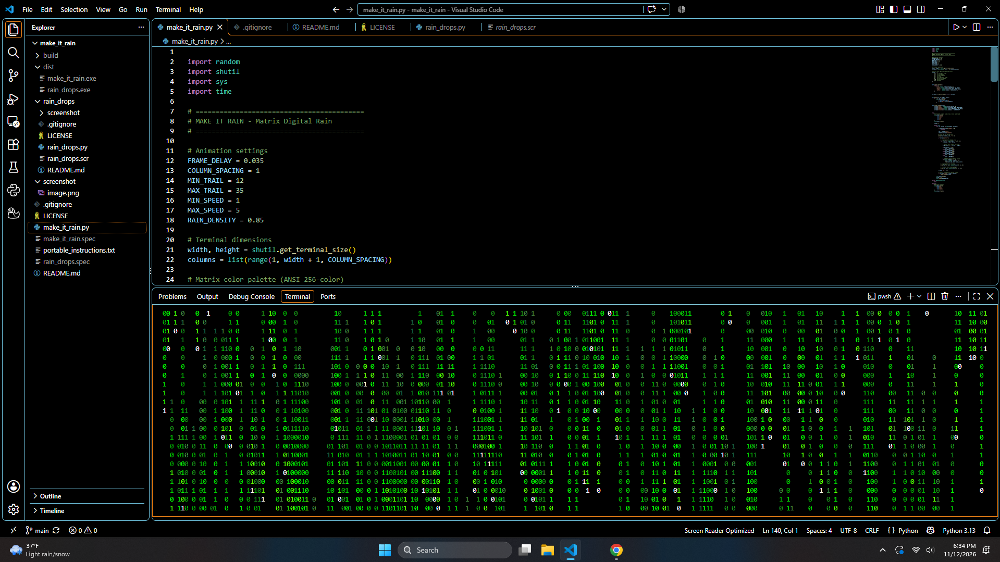

# MAKE IT RAIN 🟢


A Matrix-style digital rain animation written in Python.

Transform your Windows terminal into a cascading waterfall of neon-green binary digits.

## Features

- Full-screen terminal animation
- Randomized binary streams
- Independent falling speeds
- Variable trail lengths
- Fading green trails with bright white leading digits
- Automatic terminal size detection
- Restores the terminal when interrupted

## Requirements

**Python version:** Python 3

**Standalone Windows version:** No Python installation required.

## Run from source

```powershell
python make_it_rain.py
```

## Standalone executable

Download `make_it_rain.exe` from the GitHub Releases page and launch it on Windows.

## Controls

Press `Ctrl+C` to stop the animation.

## Built with

Python and its standard library.

No external runtime dependencies.

## License

This project is licensed under the MIT License.
See the [LICENSE](LICENSE) file for details.
